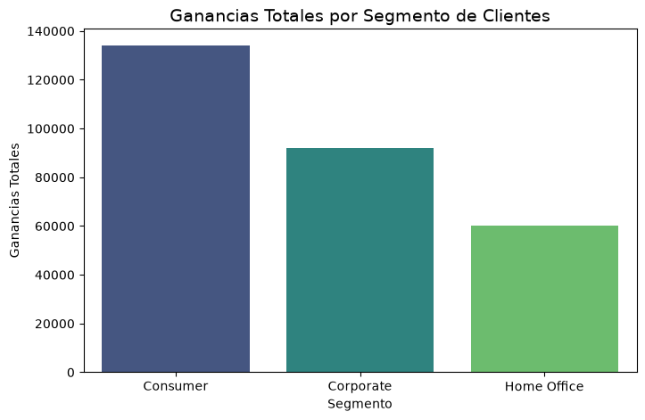
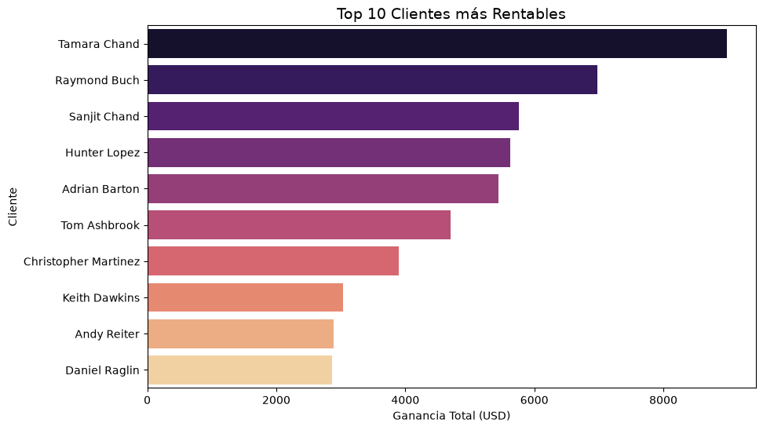

# Segmentación y Análisis de Clientes - Superstore

## 📝 Descripción
Análisis exploratorio de datos (EDA) enfocado en identificar los segmentos de clientes más rentables y los clientes "Top" que generan el mayor margen de ganancia para el negocio. Se analizaron 9,994 transacciones de la tienda Superstore.

## 🛠️ Herramientas utilizadas
*   **Python** (Pandas para manipulación y agrupación de datos)
*   **Matplotlib** y **Seaborn** (para visualización de datos)
*   **Jupyter Notebooks** (para el desarrollo del análisis)
*   **VS Code** y **Git** (control de versiones)

## 🔍 Hallazgos Principales
*   **El segmento Consumer es el motor:** Los consumidores finales generan la mayor cantidad de ganancias (más de $134,000), superando por mucho a Corporate y Home Office.
*   **Concentración de ingresos:** Existe una alta dependencia de un grupo pequeño de clientes. La cliente "Tamara Chand" es la más valiosa, generando casi $9,000 en ganancias por sí sola, seguida de Raymond Buch con casi $7,000.

## 📈 Visualizaciones

## 💡 Recomendaciones
1.  **Fidelización VIP:** Crear programas de fidelización exclusivos para el Top 10 de clientes, ya que su pérdida afectaría significativamente los ingresos.
2.  **Estrategia B2B:** Aunque Consumer es el rey, el segmento Corporate tiene un ticket promedio alto. Se podrían diseñar ofertas por volumen para aumentar su participación.

## 📂 Estructura del proyecto
*   `data/`: Datos originales (CSV).
*   `notebooks/`: Notebook con el análisis y limpieza de datos.
*   `outputs/`: Gráficos generados (Segmentos y Top Clientes).

## 🚀 Cómo ejecutar este proyecto localmente
1. Clona este repositorio: `https://github.com/DJimenez71/analisis_segmentacion.git`
2. Instala las dependencias necesarias: `pip install -r requirements.txt`
3. Abre el notebook en Jupyter o VS Code.

## 📂 Fuentes y Datos
Los datos utilizados en este proyecto provienen del dataset [Superstore Dataset](https://www.kaggle.com/datasets/yesshivam007/superstore-dataset) disponible en Kaggle.

## 👩‍💻 Autora
*Análisis realizado por Daniela Jimenez como parte de mi portafolio de análisis de datos.*
*13 de noviembre de 2026*